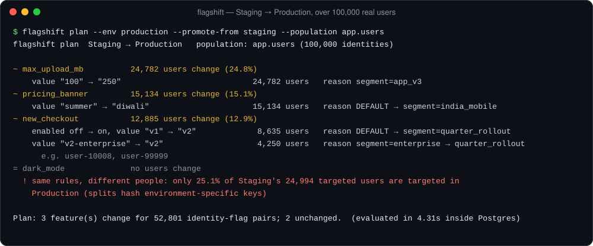

# FlagShift: `terraform plan` for flag changes

A flag change in Flagsmith takes effect at once, for everyone it matches. FlagShift shows you who it will move before
you make it. It evaluates the live and the proposed configuration over your real users in one SQL statement, and
reports every transition with its user count and its reason.



Flagsmith's Change Requests are a paid feature (Scale-Up and Enterprise). FlagShift gives open-source self-hosters a
review step, in a terminal or on a pull request.

## Plan

```bash
export PGSMITH_DSN=postgresql://...         # a role with flagsmith_planner and SELECT on the population
flagshift plan --env production --promote-from staging --population app.users
flagshift plan --env production --patch change.json --population app.users
flagshift plan --env production --candidate context.json --population app.users --format markdown
```

| Option | |
|---|---|
| `--promote-from ENV` | copy another environment's rules, overrides, weights and values into the target |
| `--patch FILE` | an [RFC 6902](https://www.rfc-editor.org/rfc/rfc6902) JSON Patch against the target's live configuration |
| `--candidate FILE` | a whole `EvaluationContext` |
| `--population` | any table or view with `identifier text` and `traits jsonb` |
| `--format` | `text` (default), `markdown` (pull requests) or `json` |

Exit codes follow `terraform plan -detailed-exitcode`: 0 means no changes, 2 means changes, and 1 means an error.

**Promotion re-keys.** Splits and variants hash keys that differ between environments (the environment key, feature
state keys, override keys, variant priorities). FlagShift copies the source's *rules* but keeps the target's *keys*,
so the plan buckets users exactly as the target will after the change. It also reports what the re-keying reveals:
the same 25% rule in staging and production selects different people.

## On pull requests

`action/action.yml` is a composite GitHub Action that posts the plan as a pull-request comment (updated on each push):

```yaml
- uses: actions/checkout@<sha>
- uses: <owner>/pgsmith/action@<tag>
  with:
    database-url: ${{ secrets.FLAGSHIFT_DATABASE_URL }}   # a flagsmith_planner role
    environment: production
    population: app.users
    patch: flags/production.json
    fail-on-changes: 'false'
```

A complete workflow is in [demos/flagshift/github/flagshift.yml](../demos/flagshift/github/flagshift.yml). The comment
shows counts and reasons, never user identifiers, and escapes configuration text. The database role needs only
`flagsmith_planner`: it can load candidates but never serve them.

## Apply, pin, history

```bash
flagshift apply --env production --patch change.json --population app.users \
  --api https://flagsmith.example.com/api/v1/ --token "$FLAGSMITH_TOKEN" --server-key ser.xxx
```

`apply` prints the plan, asks for confirmation (or `--yes`), and writes the change through Flagsmith's Admin API:
enabled states, values, multivariate weights, segment overrides and their priorities. It then re-syncs and checks that
planning again against the new live configuration shows no changes.

```bash
flagshift pin production 41      # serve snapshot 41 everywhere, now, even with Flagsmith down
flagshift unpin production       # back to the latest configuration
flagshift history production     # recent loads
```

## In SQL

The same plan is available to any SQL client: `flagsmith.plan()`, `flagsmith.plan_diff()` and
`flagsmith.cohort_overlap()` (see [SQL reference](sql-reference.md#plan-flagshift)). The plan runs in parallel and
evaluates 100,000 users against two configurations in about 4 seconds.
